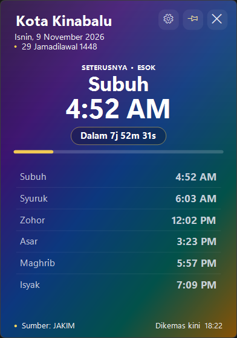

# Solat Waktu Widget untuk Windows 11

Widget desktop terapung yang memaparkan waktu solat Malaysia secara langsung daripada data JAKIM. Dibina dengan .NET 10 dan WinForms, dengan antara muka dalam Bahasa Melayu dan Inggeris.



## Ciri-ciri

- **Waktu solat rasmi JAKIM** untuk semua 60 zon JAKIM di seluruh Malaysia.
- **Sumber data berlapis**: e-Solat JAKIM dahulu, kemudian `api.waktusolat.app`, dan cache tempatan apabila tiada Internet.
- **Kiraan detik langsung** ke waktu solat seterusnya, bersama bar kemajuan antara waktu solat.
- **Senarai waktu penuh** termasuk pilihan Imsak dan Dhuha.
- **7 tema** daripada aplikasi Android asal: Midnight, Ocean, Royal, Forest, Ember, Crimson dan Pelangi.
- **3 saiz widget** (Kecil, Sederhana, Besar), mod ringkas, dan pelarasan kegelapan.
- **Bahasa Melayu dan Inggeris**: pilih bahasa dalam Tetapan. Tarikh, kiraan detik, menu, notifikasi dan label antara muka bertukar serta-merta.
- **Pratonton langsung dalam Tetapan**: bahasa, tema, saiz, kegelapan, format masa dan paparan Imsak/Dhuha berubah serta-merta. **Simpan** mengekalkan perubahan; **Batal** memulihkan semua nilai asal.
- **Timer di taskbar**: kiraan detik langsung ke solat seterusnya dalam bar mini yang mengecil mengikut teks, bertindih pada taskbar dan boleh diletakkan di Kiri, Tengah, atau Kanan, atau dimatikan sepenuhnya. Kedudukan Kanan kekal clear daripada ikon aplikasi, tray dan jam.
- **Uji notifikasi dan bunyi** dalam Tetapan: pratonton toast dan main azan pilihan tanpa menunggu waktu solat.
- **Format 12 jam** menggunakan akhiran `AM`/`PM`.
- **Notifikasi desktop** tersendiri untuk setiap waktu solat.
- **Azan** pendek atau panjang dengan pelarasan kelantangan dan pilihan waktu.
- **Ikon tray ungu ringkas** dengan menu klik kanan, sembunyi ke tray, dan buka semula.
- **Mula bersama Windows** melalui tetapan aplikasi.
- **Sentiasa di atas**, pin, snap ke tepi skrin, dan ingat kedudukan terakhir.
- **Satu contoh sahaja** berjalan; melancarkan semula aplikasi akan memunculkan widget sedia ada.
- Widget kekal berfungsi di luar talian menggunakan cache bulan semasa.

## Keperluan

- Windows 10 versi 1809 atau lebih baru, atau Windows 11 (64-bit).
- Pemasang sudah mengandungi runtime .NET 10 — tiada pemasangan .NET berasingan diperlukan.
- Sambungan Internet untuk data waktu solat terkini. Cache digunakan jika tiada Internet.

## Pemasangan

1. Jalankan `dist\SolatWaktuWidget-Setup-1.0.0.exe`.
2. Ikut wizard pemasangan. Pemasangan adalah untuk pengguna semasa dan tidak memerlukan hak pentadbir.
3. Pilih zon JAKIM anda semasa pelancaran pertama.
4. Widget akan muncul di penjuru kanan bawah skrin.

Pilihan pemasang:

- Cipta ikon desktop.

Untuk mula bersama Windows, aktifkan **Mula bersama Windows** dalam Tetapan widget selepas pemasangan.

Untuk nyahpasang, gunakan **Tetapan > Aplikasi > Aplikasi terpasang** atau pintasan **Nyahpasang Solat Waktu Widget** dalam menu Mula.

## Penggunaan

| Tindakan | Cara |
| --- | --- |
| Pindahkan widget | Seret kawasan tajuk |
| Mod ringkas | Klik dua kali kawasan tajuk |
| Tetapan | Klik ikon gear |
| Tukar bahasa | Dalam **Tetapan**, pilih **Bahasa Melayu** atau **English** |
| Pratonton tetapan | Ubah pilihan dan lihat kesan pada widget serta-merta; **Simpan** untuk kekalkan atau **Batal** untuk pulihkan |
| Pin sentiasa di atas | Klik ikon pin |
| Sembunyi ke tray | Klik X atau tekan `Esc` |
| Buka semula | Klik dua kali ikon tray, atau lancarkan aplikasi semula |
| Menu pantas | Klik kanan pada widget atau ikon tray |
| Segarkan data | `Ctrl+R` atau menu **Segarkan Data** |
| Tetapan | `Ctrl+,` |
| Tukar zon | Menu **Tukar Zon...** |

Menutup widget dengan X tidak menghentikannya. Gunakan **Keluar** dalam menu tray atau menu klik kanan untuk menghentikan aplikasi sepenuhnya.

## Sumber data dan privasi

- Data waktu solat diambil daripada [e-Solat JAKIM](https://www.e-solat.gov.my/) dan [api.waktusolat.app](https://api.waktusolat.app/).
- Tiada telemetri, pengiklanan, atau muat naik data pengguna.
- Tetapan disimpan di `%LocalAppData%\SolatWaktuWidget\settings.json`.
- Cache bulanan disimpan di `%LocalAppData%\SolatWaktuWidget\cache`.
- Fail audio azan diekstrak ke `%LocalAppData%\SolatWaktuWidget\audio` semasa pertama kali digunakan.

Untuk memadam semua data aplikasi, keluar dari widget dan padam folder `%LocalAppData%\SolatWaktuWidget`.

## Membangunkan

Keperluan: .NET SDK 10.

```powershell
# Bina
dotnet build src\SolatWaktu.Widget\SolatWaktu.Widget.csproj -c Debug

# Jalankan ujian
dotnet test tests\SolatWaktu.Core.Tests\SolatWaktu.Core.Tests.csproj -c Release

# Terbitkan versi mudah alih (self-contained, satu fail)
installer\publish.ps1

# Bina pemasang (memerlukan Inno Setup 6)
installer\build-installer.ps1
```

Hasil terbitan berada di `publish\`, dan pemasang di `dist\`.

### Struktur projek

```text
src\SolatWaktu.Core          Model, penyedia data, cache, pengiraan jadual
src\SolatWaktu.Widget        Aplikasi WinForms, tema, audio, tray
tests\SolatWaktu.Core.Tests  Ujian unit xUnit
installer\                   Skrip terbitan dan Inno Setup
```

## Penyelesaian masalah

**Windows SmartScreen menyekat pemasang.**
Pemasang ini belum ditandatangani secara digital. Klik **More info > Run anyway** untuk meneruskan, atau bina sendiri daripada kod sumber.

**Widget tidak muncul selepas dipasang.**
Lancarkan **Solat Waktu Widget** dari menu Mula. Jika widget sudah berjalan tetapi tersembunyi, klik dua kali ikon tray.

**Data tidak dikemas kini.**
Semak sambungan Internet dan klik **Segarkan Data**. Jika masih gagal, padam folder cache dan segarkan semula.

**Tidak ada bunyi azan.**
Pastikan **Main azan** diaktifkan dalam Tetapan, waktu yang dipilih ditanda, dan kelantangan sistem tidak senyap. Uji dengan fail azan pendek terlebih dahulu.

**Notifikasi tidak muncul.**
Pastikan **Notifikasi waktu solat** diaktifkan. Notifikasi dipaparkan sebagai tetingkap kecil di penjuru skrin dan bukan melalui Pusat Tindakan Windows.

**Zon salah.**
Buka **Tukar Zon...**, cari daerah atau kod JAKIM (contohnya `WLY01`), dan pilih zon yang betul.

## Penghargaan

- Data waktu solat: Jabatan Kemajuan Islam Malaysia (JAKIM).
- API alternatif: [waktusolat.app](https://api.waktusolat.app/).
- Audio azan dan tema warna diadaptasi daripada projek Android asal pengguna.
- Ikon masjid ringkas berwarna ungu dijana untuk widget; imej notifikasi menggunakan aset masjid ungu.
